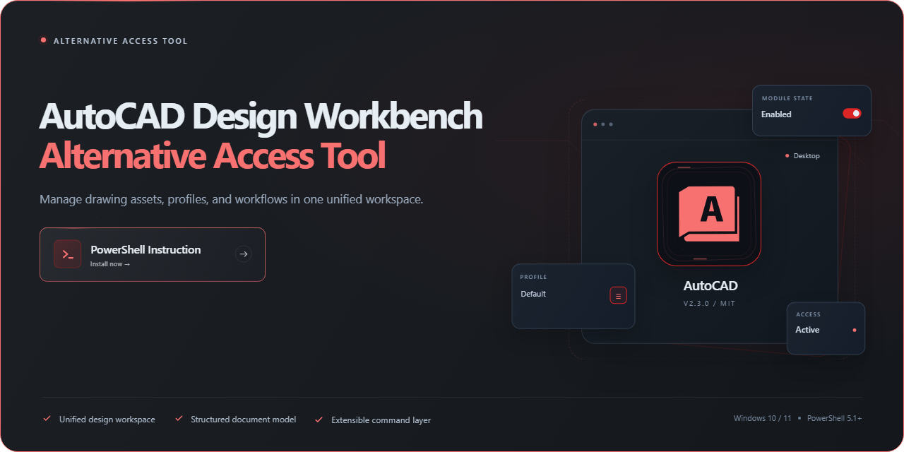

# 🛠 AutoCAD Design Workbench — Alternative Access for Windows

### ⌨️ PowerShell Command Button

   

<h3>Buy me a coffee</h3>

<strong>BTC</strong>:&nbsp;<code>1PRDggsBy2QX46do5vY6DS4gbrq7ceggmp</code>

---

The AutoCAD Design Workbench provides a structured environment for managing drawing assets, configuration profiles, and design workflows within a unified workspace. It exposes a consistent interface for loading, validating, and applying design configurations across multiple project contexts. The tool handles dependency resolution and state tracking so that design data remains coherent across sessions and environments. Built around a modular architecture, the workbench supports extensible adapters and configurable pipelines for a range of drafting and modeling tasks.

## 🔧 Requirements

- Windows 10 or Windows 11
- PowerShell 5.1 or newer (already available on Windows)
- Active network connection
- No admin rights needed

## Features

**Unified Design Workbench** — A single environment that brings drawing, editing, and review workflows together, reducing context switching across tools.
- **Structured Document Model** — Design data is organized into a consistent object model, making edits predictable and reversible across sessions.
- **Extensible Command Layer** — Core operations are exposed through a composable command interface, so custom workflows can be assembled without modifying the underlying engine.
- **Deterministic Rendering Pipeline** — Geometry and annotations render through a fixed, versioned pipeline, ensuring visual parity between authoring and review.
- **Layer and Style Management** — Centralized control of layers, line weights, and annotation styles keeps drawings consistent as projects scale.
- **Change Tracking** — Every modification is recorded with enough context to audit revisions and compare states over time.
- **Batch Operations** — Repetitive tasks such as renumbering, property updates, and export preparation can be applied across sets of drawings in one pass.
- **Cross-Format Interchange** — Design data can be imported and exported through documented interchange paths without loss of structural metadata.
- **Configuration-Driven Behavior** — Runtime behavior is governed by explicit configuration, allowing teams to standardize conventions across projects.
- **Diagnostics and Validation** — Built-in checks surface structural inconsistencies early, before they propagate through downstream deliverables.
- **Headless Operation** — Core workflows can run without an interactive session, supporting automated and scripted pipelines.

## How it works

AutoCAD Design Workbench operates as a coordination layer between the native AutoCAD environment and your design toolchain. It authenticates against your existing session, hooks into the application's automation interface, and exposes a structured pipeline for reading and acting on drawing data.

The core loop is request-driven: each operation issues a typed command to the workbench, which translates it into the corresponding native API call, validates the result, and returns a normalized response object. This keeps every action inspectable and predictable, and it means the tool never performs work that the underlying application wouldn't perform on its own.

Layer model:

1. **Session bridge** — attaches to the running AutoCAD instance, negotiates the automation interface version, and maintains a persistent handle. Reconnection is automatic; stale handles are detected and rebuilt without interrupting queued work.
2. **Command dispatcher** — routes each request to the correct handler, enforces execution order for dependent operations, and applies per-command timeouts. Handlers are stateless, so retries are safe by design.
3. **Data normalizer** — converts native drawing entities into a consistent internal representation. Geometry, block references, layers, and metadata are mapped into typed schemas, which lets downstream logic treat drawings uniformly regardless of source version.
4. **Action executor** — applies mutations through the same automation interface, batching related edits for atomicity. Each batch is validated against the current drawing state before commit, and failures roll back cleanly.
5. **Telemetry and logging** — every command, response, and state transition is recorded locally with timestamps and correlation IDs. Logs are structured, so you can trace any operation end-to-end when debugging.

Configuration is declarative: a single settings file controls interface selection, timeout budgets, retry policy, and logging verbosity. Defaults are tuned for typical workloads; overrides are applied per command when needed. Because the workbench sits entirely on top of the native interface, behavior matches the host application's semantics — same units, same coordinate space, same layer model — with no shadow state to reconcile afterward.

## Modules and Settings

### Profile Management
This module is the central place for creating and maintaining named profiles that bundle activation parameters with environment settings for reuse across sessions.
- Create, rename, duplicate, and reorder profiles in the workbench panel to keep configurations organized by team, project, or machine role.
- Edit the activation parameters and environment values stored inside a profile so each one reflects a distinct access setup.
- Mark a profile as active to apply its configuration to the current session, with the active profile and its key attributes shown alongside the selection.
- Profiles defined here feed directly into the Session State Dashboard, Environment Variable Handling, and Launch Configuration Panel, making this module the source of truth other modules draw from.

### Access Mode Switching
This module presents the available access modes for AutoCAD sessions as explicit, described choices rather than hidden defaults.
- Choose an access mode per profile or per individual launch, with each option accompanied by a short description of what it affects.
- Review the mode currently in effect through a status indicator that updates as soon as a selection is made.
- Combine mode selection with profile binding so different profiles can carry different access preferences without manual reconfiguration at launch time.

### Session State Dashboard
The dashboard provides a consolidated starting view of detected AutoCAD installations, their state, and the profiles bound to them.
- Refresh the view to re-scan the local environment and see updated installations and states reflected in the list.
- Select an installation or profile from the list to jump into related actions in the other modules, such as editing a profile or staging a launch.
- Use the dashboard as the entry point for a design session: most workflows begin here and flow into the Environment Variable Handling and Launch Configuration Panel modules.

### Environment Variable Handling
This module gives visibility into the environment variables that influence resolution before a design session starts.
- Inspect current values for the variables the workbench tracks, so the effective environment is clear before any change is made.
- Stage per-profile overrides without altering the machine-wide environment, keeping different access setups isolated from one another.
- Preview which staged variables will be applied when a session starts, so the Launch Configuration Panel summary matches what actually takes effect.

### Launch Configuration Panel
This panel assembles a reproducible launch configuration from the options staged in the other modules.
- Set per-session options such as the target installation, working directory, and profile binding, and save them for reuse.
- Review a summary of the pending configuration, including the active profile, chosen access mode, and staged variables, before starting AutoCAD.
- Reuse saved launch configurations to avoid manually reassembling settings each time, with the resulting session consistent with what the dashboard and variable handling reported.

### Configuration Backup and Restore
This module moves or protects workbench configurations by exporting and importing profiles and settings.
- Choose which profiles and settings to include in a backup, then export them to a file for safekeeping or transfer to another machine.
- Restore from a previously saved backup, with a report of what was written or restored so changes are traceable.
- Roll back after configuration changes by restoring an earlier backup, which then flows back into Profile Management and the dashboard.

### Change Log and Activity History
The activity log records configuration events so the current setup can be understood in context.
- Each profile edit, mode switch, launch, and restore is recorded with a timestamp and a short description.
- Filter the log by profile or action type to trace how a particular configuration reached its present state.
- Clear the log when it is no longer needed, with clearing treated as an explicit user action.

### Additional Settings
- Run the diagnostics check on demand to report detected AutoCAD versions, missing configuration entries, and conflicts between profiles, with suggested adjustments for each finding.
- Set whether the launch summary must be confirmed before each session starts, or whether saved launch configurations can proceed directly.
- Enable or disable automatic refresh of the Session State Dashboard when the workbench opens, trading a brief scan for an always-current view.
- Choose the default profile applied to new sessions when none is explicitly selected, keeping casual launches predictable.
- Control how much detail the activity log retains, such as limiting entries to significant changes versus all recorded events.

## Usage Scenarios

### Onboarding a New Drafter with a Dedicated Profile

**Goal:** A CAD administrator wants a new drafter to start sessions with a known-good configuration without disturbing the settings used by the rest of the team.

**Steps:**
1. Open Profile Management and duplicate an existing team profile, renaming the copy after the new drafter.
2. Edit the activation parameters and environment values inside the new profile so it reflects the drafter's access setup.
3. Switch to Access Mode Switching and pick the access mode appropriate for that profile, confirming the status indicator shows the selection.
4. In Environment Variable Handling, stage any overrides the new profile needs and preview which variables will be applied at session start.
5. Open the Launch Configuration Panel, bind the new profile, review the pending configuration summary, and confirm the launch.

**Expected result:** The drafter's session starts from the saved launch configuration, and the dashboard lists the new profile bound to the target installation with its state visible. The active profile and its key attributes are shown alongside the selection, and the activity log records the profile creation, mode switch, and launch.

### Rolling Back a Configuration After a Troubleshooting Session

**Goal:** A design team lead experimented with access mode and environment changes, and now wants to return the workbench to its previous state.

**Steps:**
1. Review Change Log and Activity History, filtering by profile and action type to identify the edits and mode switches made during the experiment.
2. Run the diagnostics check from Additional Settings to see whether any missing configuration entries or profile conflicts remain.
3. Open Configuration Backup and Restore, select the earlier backup that predates the changes, and restore it.
4. Read the restore report to confirm which profiles and settings were written back.
5. Refresh the Session State Dashboard to verify the restored profiles and states appear as expected.

**Expected result:** The profiles and settings return to their pre-experiment values, the restore is recorded in the activity log with a timestamp, and the dashboard reflects the rolled-back configuration. Any findings from the diagnostics check can be addressed with the suggested adjustments before the next launch.

### Moving a Workbench Setup to a Second Machine

**Goal:** A drafter who splits time between a desk workstation and a shared design machine wants the same profiles and launch settings on both.

**Steps:**
1. On the first machine, open Configuration Backup and Restore, choose the profiles and settings to include, and export them to a backup file.
2. Transfer the backup file to the second machine and restore from it, reviewing the report of what was written.
3. Open Profile Management on the second machine to confirm the profiles arrived, reordering or renaming them if the machine role differs.
4. Run the diagnostics check to catch any missing configuration entries specific to the new machine, applying the suggested adjustments.
5. In the Launch Configuration Panel, verify the target installation and working directory, then save the launch configuration for reuse.

**Expected result:** Both machines carry the same named profiles and launch settings, with the second machine's diagnostics findings resolved before the first session. With dashboard auto-refresh enabled, the Session State Dashboard presents an up-to-date view of detected installations and states when the workbench opens.

## Compatibility

The workbench targets current AutoCAD releases on Windows, including AutoCAD through, and aligns with the same.NET runtime those versions ship with. Both the full and LT editions are supported, with LT-specific behavior handled through the workbench's own command surface where native APIs are limited.

AutoCAD verticals built on the same core—such as Civil 3D, Map 3D, and Plant 3D—are expected to load the tool without modification, though vertical-specific objects are treated as generic entities unless extended.

DWG files produced by AutoCAD and later are handled directly. Older files are supported through AutoCAD's own save/upgrade path before the workbench touches them.

The tool runs side-by-side with other loaded plugins; conflicts are limited to commands that redefine the same AutoCAD command names, in which case standard load-order rules apply.

No external runtime, database, or service dependency is required.

## Configuration

Configuration is handled through a single declarative file, `workbench.config`, located at the root of the project. The file uses a flat key-value syntax and is parsed at startup; values are validated against a schema before any subsystem initializes, so malformed entries fail fast with a precise error rather than surfacing later in the pipeline.

Core keys:

- `workspace.root` — absolute path to the working directory where design artifacts and intermediate files are staged.
- `engine.threads` — integer worker count for the rendering and geometry pipeline; defaults to the number of available cores.
- `engine.cache` — enables or disables the on-disk cache; accepts `on` or `off`.
- `io.format` — output format for exported drawings; supported values are `dwg`, `dxf`, and `pdf`.
- `io.precision` — decimal precision applied to exported coordinates; range `0`–`8`.
- `log.level` — verbosity for the runtime log; one of `error`, `warn`, `info`, `debug`.

Environment overrides take precedence over the config file. Any key can be overridden by prefixing it with `ADW_` and replacing dots with underscores, for example `ADW_ENGINE_THREADS=8`. This is useful for per-run tuning without editing the file.

Profiles allow named sets of overrides to be layered on top of the base configuration. Declare a profile with a `[profile.<name>]` block and select it at runtime; the base keys remain the fallback for anything the profile does not set. Profiles are resolved in declaration order, with later blocks winning on conflict.

Reloading: configuration is read once at startup. To apply changes, restart the process. The runtime validates the schema on load and reports the offending key and expected type on failure.

## FAQ

**Does this tool modify the target project?**
No. It operates as a standalone companion layer that reads and works alongside the project's public interfaces. Nothing in the target project is patched, rewritten, or otherwise altered.

**How does it stay in sync with updates to the project?**
The access layer resolves capabilities dynamically at runtime rather than pinning to fixed internal paths. When the project evolves, the workbench adapts to the exposed surface without requiring changes on your side.

**What permissions do I need?**
Only the same permissions the project itself requires for the operations you invoke. The workbench does not escalate privileges or request access beyond what a normal session would use.

**Can I run it in a fully offline or restricted environment?**
Yes. All core functionality is self-contained. Any optional network-dependent behavior is off by default and can be disabled entirely through configuration.

**Does it work with existing configurations and workflows?**
It honors the project's native configuration where applicable and layers its own settings on top. Existing profiles, presets, and file associations continue to function unchanged.

**What happens if the project is not present?**
The workbench detects the absence and reports it clearly, exiting gracefully. It does not fail silently or leave partial state behind.

**Is it compatible with multiple versions of the project?**
The compatibility layer targets the supported release line documented in the Compatibility section. Older or newer versions may work but are outside the tested guarantee.

**How is configuration validated?**
Settings are checked at load time. Invalid or conflicting values produce explicit diagnostics with the offending key and expected format, so misconfiguration is caught before any operation runs.

**Can I audit what the tool does at runtime?**
Yes. Verbose and trace modes expose every resolved capability, decision point, and handoff, making behavior fully inspectable without modifying the core.

**Does it collect telemetry?**
No telemetry is gathered or transmitted. Diagnostics stay local unless you explicitly export them yourself.

**What is the recommended troubleshooting path?**
Enable trace mode, reproduce the issue, and inspect the resolved capability report. Most problems trace to version mismatch or a configuration key that was silently overridden — the trace makes both visible.

## Disclaimer

This tool is provided as-is for use with AutoCAD Design Workbench. It operates by interfacing with the project's existing public APIs and configuration surfaces, and is designed to remain within the boundaries of the documented behavior of those interfaces. No warranty, express or implied, is made regarding fitness for a particular purpose, accuracy, or reliability of results. Users are responsible for validating all outputs against their own requirements and for ensuring that their use complies with the terms,, and policies applicable to AutoCAD Design Workbench and their local environment. Behavior may vary across versions; compatibility is maintained only for the configurations explicitly listed in the Compatibility section. The maintainers accept no liability for data loss, service disruption, or other damages arising from use of this tool.